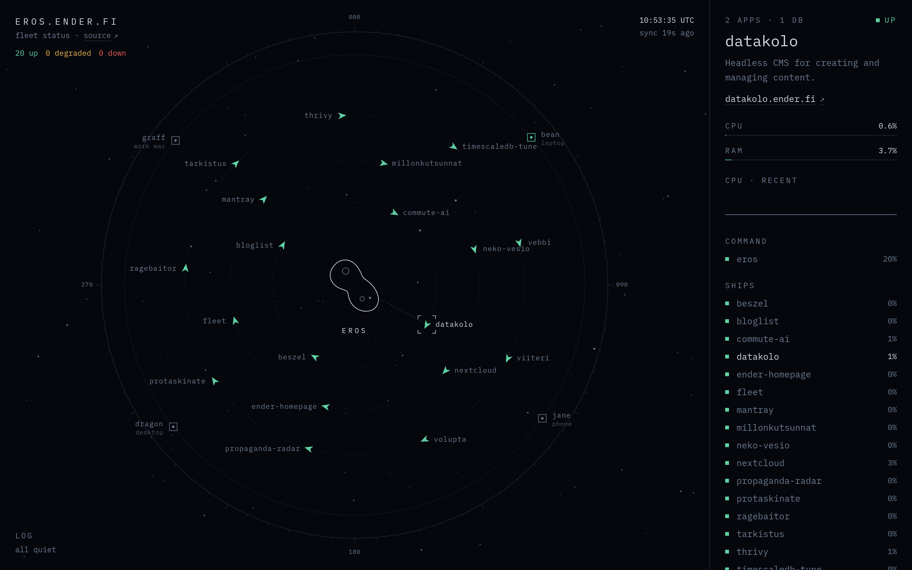
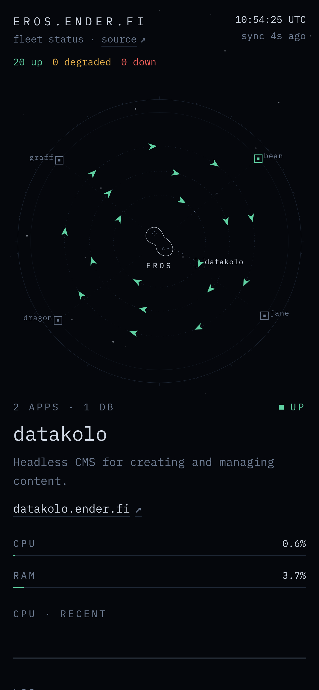

# fleet

A live map of a Coolify server and the projects running on it. The server is an
asteroid in the middle, projects orbit it as ships, and other machines sit at
the edge as outposts. Statuses, names and links come from Coolify. CPU, RAM and
machine status come from [Beszel](https://beszel.dev) if you run it.

Mine runs at [eros.ender.fi](https://eros.ender.fi).

<p>
    
    
</p>

## Run it on Coolify

1. In Coolify, turn on API access in the settings and create an API token under
   Keys & Tokens with only the `read` permission.
2. Add a new resource from the Docker image `ghcr.io/3nd3r1/fleet:latest` and
   expose port 3000.
3. Add these as runtime environment variables:
    ```
    COOLIFY_URL=https://coolify.example.com
    COOLIFY_TOKEN=your-read-only-token
    ```
4. Deploy and give it a domain.

That's enough for a working page. Every app, service and database shows up,
grouped into projects by name (`blog-frontend` and `blog-backend` become
`blog`). Set `/api/ping` as the health check path if you want one.

## Run it with Docker

```bash
docker run -d -p 3000:3000 \
  -e COOLIFY_URL=https://coolify.example.com \
  -e COOLIFY_TOKEN=your-read-only-token \
  ghcr.io/3nd3r1/fleet:latest
```

There's a Compose file in [`examples/docker-compose.yml`](examples/docker-compose.yml).

## Configure it

Configuration is optional. It sets the page title and favicon, names,
descriptions and links for projects, which projects to hide, and machines
outside Coolify:

```json
{
    "site": { "title": "my-server.example.com" },
    "core": { "name": "mothership" },
    "projects": {
        "blog": { "description": "Where I write things." },
        "api-gateway": { "hidden": true }
    },
    "machines": [{ "id": "laptop", "role": "laptop" }]
}
```

Mount it at `/app/fleet.config.json`. On Coolify, add it under the app's
Persistent Storage as a File Mount with that path, so you can edit it in the
dashboard, and restart the app after editing. `FLEET_CONFIG_JSON` also works
if you'd rather use an environment variable. Every option is in
[docs/configuration.md](docs/configuration.md).

## Add metrics with Beszel

With a Beszel hub, fleet shows CPU, RAM and uptime for the server, CPU and RAM
for each project, and whether your other machines are online.

1. In the hub, create a user with the read-only role and mark it verified.
2. Set `SHARE_ALL_SYSTEMS=true` on the hub so that user can see every system.
3. Add to fleet:
    ```
    BESZEL_URL=https://beszel.example.com
    BESZEL_EMAIL=readonly@example.com
    BESZEL_PASSWORD=...
    ```

Systems are matched by name, ignoring case, so a Beszel system called "Eros"
belongs to a core or machine called `eros`. If Beszel is down, the map keeps
working without numbers.

## Machines without Beszel

A phone can't run a Beszel agent, so it can check in instead. Set
`FLEET_HEARTBEAT_TOKEN`, add `"heartbeat": 900` to the machine, and have an
automation app like MacroDroid call `POST /api/heartbeat/<machine>` every 5
minutes. The machine is up while the calls arrive and offline after 900 seconds
without one. Setup is in
[docs/configuration.md](docs/configuration.md#heartbeats).

## Check your setup

The doctor command reads the config, talks to Coolify and Beszel, and says what
matched and what didn't. It doesn't print tokens, passwords or IPs. Run it in
the container, for example from the terminal in Coolify:

```
$ bun server/doctor.ts
✓ config loaded from FLEET_CONFIG_JSON
✓ Coolify: 1 server(s), 27 resources, shown as 18 projects
· no description: mantray, vebbi
✓ eros uses Beszel system "Eros"
! machines without a Beszel system: graff
✓ heartbeats on for jane
✓ public data has no IPs, ports or versions
```

It exits with 1 if something failed.

## What's public

The page is meant to be public, so the backend is strict about what it sends:

- Only the backend talks to Coolify and Beszel. Tokens and passwords never
  reach the browser.
- Responses from both are parsed against a list of allowed fields, so IPs,
  ports, hostnames, versions and settings are dropped as they come in.
- Descriptions that look like an IP, port or version are dropped.
- Links are only shown for plain `https` domains. Backends, APIs, agents,
  ports, IPs and sslip.io-style hosts are never linked.
- Coolify and Beszel are asked at most once per cache period (20 seconds by
  default), however many people have the page open.
- The page is served with a strict Content-Security-Policy and can't be put in
  a frame on another site.
- Heartbeats need the token. What they report is public, though: anyone can
  see when a machine is online and, if you send it, its battery level.

Every project name in Coolify shows up on the page. Hide the ones that
shouldn't be public with `"hidden": true`.

## Development

See [docs/development.md](docs/development.md).

## License

MIT
